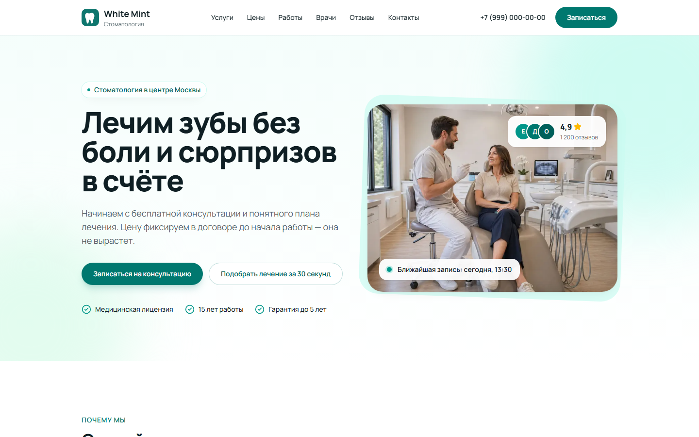
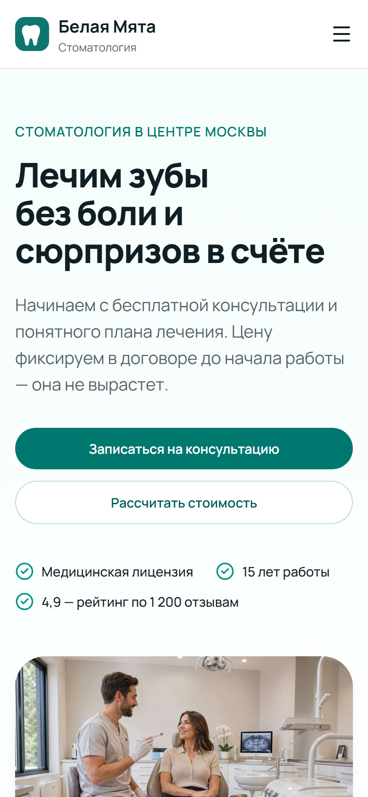

# Белая Мята — лендинг стоматологической клиники

Одностраничный сайт вымышленной стоматологии в Москве. Проект для портфолио: клиника, врачи, отзывы и контакты выдуманы.

**Демо:** https://grozeser.github.io/dental-landing/

| Десктоп | Мобильный |
| --- | --- |
|  |  |

## Что внутри

- **Калькулятор стоимости.** Отмечаете процедуры, для поштучных задаёте количество зубов, сразу видите итог и платёж в рассрочку. Кнопка «Записаться с этим расчётом» передаёт выбор в форму записи.
- **Слайдер «до/после».** Три кейса во вкладках, ползунок перетаскивается мышью, пальцем или стрелками.
- **Форма записи.** Маска телефона `+7 (999) 123-45-67`, проверка полей, понятные ошибки, фокус на первом ошибочном поле, экран успеха.
- **Анимации при скролле.** Карточки плавно появляются, счётчики «12 000+ пациентов» досчитывают до значения. Если в системе включено «уменьшить движение», анимаций нет.
- Отзывы — горизонтальная лента на CSS scroll-snap, FAQ — нативные `<details>`. Ни там, ни там JavaScript не нужен.

## Стек

Next.js 16 (App Router, static export) · React 19 · TypeScript · Tailwind CSS 4 · react-hook-form + zod · lucide-react · Vitest · GitHub Actions → GitHub Pages

## Решения, которые стоит посмотреть

- **Почти всё — серверные компоненты.** В браузер уходит JS только для шапки с мобильным меню, калькулятора, слайдера, формы и счётчиков. Остальные секции — статический HTML.
- **Один IntersectionObserver на всю страницу.** Секции только помечают элементы `data-reveal`, анимацию делает CSS ([RevealObserver.tsx](src/components/ui/RevealObserver.tsx)). Без JS всё видно сразу.
- **Слайдер на нативном `<input type="range">`.** Клавиатура, тач и скринридеры работают без дополнительного кода ([BeforeAfter.tsx](src/components/sections/BeforeAfter.tsx)).
- **Весь контент в одном файле** [content.ts](src/data/content.ts): услуги, цены, врачи, отзывы. Компоненты только отображают данные.
- **Без стороннего iframe карты.** Нарисованная SVG-карта и ссылки в Яндекс Карты и 2ГИС: нет чужих скриптов, cookie и рекламных плашек.
- **Доступность (WCAG 2.1 AA):** контраст текста от 5.2:1, рамки полей 3.3:1, skip-link, `aria-invalid`/`aria-describedby` у ошибок, `aria-live` для результата отправки, видимый фокус, вкладки со стрелками.
- **SEO:** Open Graph-картинка для превью в мессенджерах, canonical, разметка schema.org `Dentist` (JSON-LD).

## Запуск

```bash
npm install
npm run dev        # http://localhost:3000
npm test           # юнит-тесты: маска телефона, калькулятор, схема формы
npm run build      # статика в out/
```

Деплой автоматический: каждый push в `main` прогоняет lint, проверку типов и тесты, собирает сайт и публикует на GitHub Pages ([deploy.yml](.github/workflows/deploy.yml)).

## Ограничения демо

- **Форма не отправляет данные.** На GitHub Pages нет сервера, поэтому отправка имитируется. Для реального проекта место подключения бэкенда (Formspree, Telegram-бот, CRM) отмечено комментарием в [Booking.tsx](src/components/sections/Booking.tsx).
- **Фото «до» в слайдере** — та же фотография с CSS-фильтром: реальных снимков пациентов у демо-проекта нет.

## Фото

[Unsplash](https://unsplash.com/license), бесплатная лицензия: [hero](https://unsplash.com/photos/Bg81yWKZlMg), врачи — [1](https://unsplash.com/photos/5vfc-1KQLtE), [2](https://unsplash.com/photos/jDem8tPXwOA), [3](https://unsplash.com/photos/XqMo4OlBnh0), [4](https://unsplash.com/photos/_4xStiTXY1o), улыбки — [1](https://unsplash.com/photos/s5TU52ZjaFA), [2](https://unsplash.com/photos/RCQnbyQsnUg), [3](https://unsplash.com/photos/7Mut2WMWttA).
